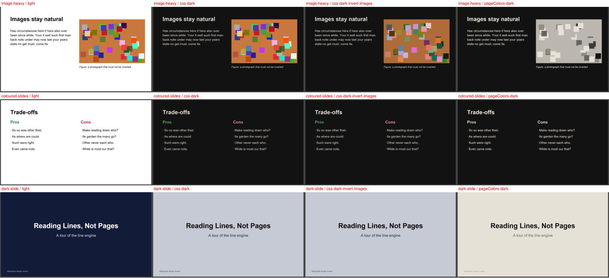
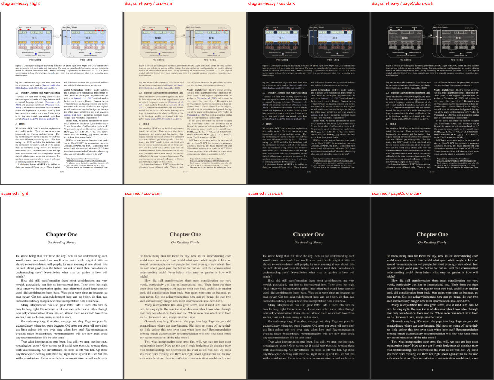

# ADR 0002 — Document theming (spike S2): CSS filter + image restore; no `pageColors`

- Status: accepted (2026-10-02)
- Requirements: PRD §8.7, §11 S2, FR-THM-01..05, NFR-PERF-05, H4

## How PDF.js 6.3.289 actually applies `pageColors`

- Entry point: `new PDFViewer({ pageColors: { background, foreground } })`. `setDocument()` copies it into
  every `PDFPageView`; each render passes it to `PDFPageProxy.render()`.
- Mechanism: **not** a per-operator colour override. After drawing, `CanvasGraphics.#drawFilter()` redraws
  the *whole canvas* through an SVG "HCM" filter (`DOMFilterFactory.addHCMFilter`): every pixel → luminance →
  a **6-step discrete ramp** from foreground to background. Images, photos and coloured vector art are
  posterized to the ramp (and luminance-inverted for dark themes). `#000/#fff` is a no-op.
- Runtime switching: there is **no setter**. Changing it means rebuilding the viewer (`setDocument` again:
  no re-parse, but every page view, text layer and overlay is recreated) or mutating private page-view
  state (forbidden, CLAUDE.md rule 9).

So H4's premise ("`pageColors` recolours vector text, photos untouched") does not hold for the pinned version.

## Decision

One strategy, `cssFilter`, for every document (the `pageColors` branch of §8.7 is dropped):

| Theme | Filter on `.canvasWrapper` (composite-time only; canvas pixels untouched) |
|---|---|
| Light | none |
| Warm | `url(#mg-warm)`: per-channel linear map, black → `pageFg`, white → `pageBg` (exact tokens) |
| Dark | `hue-rotate(180deg) url(#mg-dark)`: luminance inverted with hue kept, black → `pageFg`, white → `pageBg` |

The filters are inline SVG `feComponentTransfer` (`type="linear"`, `color-interpolation-filters="sRGB"`)
generated from the theme tokens, so any token change stays exact. (`hue-rotate` commutes with inversion
because its matrix rows sum to 1.)

**Images in dark themes** ("Invert images" toggle, FR-THM-02): with the toggle OFF (default for text PDFs),
image regions are restored from the *unfiltered* canvas pixels into small overlay canvases placed just above
`.canvasWrapper` (below the text layer and our overlays). Image rects come from PDF.js's own image tracker
(`PDFViewer({ imagesRightClickMinSize })` → `pdfPage.imageCoordinates`, normalised to the canvas). A page
whose images cover > 80 % of it is treated as **scanned** and stays filtered (inverted), which is the
"default ON for scanned" behaviour; the toggle ON disables restoration everywhere. Warm/Light never restore.

## Evidence (`node spikes/theme/run.mjs`, Chromium, DPR 1, pages ~1,450–1,480 × 830–2,180 px)

| Check | cssFilter | pageColors (rebuild) | Gate |
|---|---|---|---|
| Visible-page switch | **5–86 ms** (incl. image restore) | 45–176 ms per visible page, grows with visible pages | < 300 ms ✅ (css) |
| Text contrast Warm / Dark (text-only page) | **11.0 / 14.4** (bg `#F4ECD7` / `#121212`) | 11.0 / 14.4 | ≥ 4.5 ✅ |
| Image fidelity in Dark (mean abs diff vs Light, 0–255) | **6.1** with restore (40.1 inverted) | 82.9 (posterized) | "not inverted" ✅ (css + restore) |
| Coloured text / diagrams in Dark | hue kept (green/red stay green/red) | grayscale | — |

Corpus (≥ 6): text-only (01), image-heavy slide (04 p3), coloured slide (04 p4), dark slide (04 p1),
scanned (08), scanned + hidden OCR (09), sidebar/mixed (03), diagram-heavy real paper (BERT p3).

## Consequences / follow-ups for T-209

- Theme switch = class change only: no re-render, no re-parse (FR-THM-04), instant (NFR-PERF-05).
- **Already-dark pages** (e.g. a navy slide) get inverted to light by any inversion strategy. T-209 should
  sample the rendered canvas (downscaled mean luminance) and skip the dark filter on pages that are already
  dark (< 0.35).
- Image restore reads the main canvas; with PDF.js's high-zoom *detail canvas*, restored images can be
  softer than the surrounding text. Acceptable for v1.
- `imagesRightClickMinSize` also adds invisible right-click "save image" placeholders to the text layer;
  harmless, but line hit-testing must not depend on the event target being a text span.
- `pageColors` stays unused unless a future PDF.js version restores render-time colour overrides (re-run S2
  on any `pdfjs-dist` upgrade, R9).
